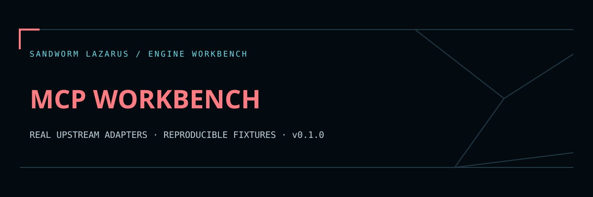

# Sandworm MCP Workbench



ตรวจสัญญา MCP tool ก่อนอัปเดต Agent: สร้าง snapshot ของ schema แล้วเทียบ tool ที่เพิ่ม ลบ หรือเปลี่ยน พร้อมชุดทดลองที่เรียก **MCP Inspector จริง** กับ server สมมติแบบอ่านอย่างเดียว

An original Sandworm contract-review harness around the official MCP Inspector. It combines exact-input SHA-256, canonical contract hashing, baseline comparison, a fixed read-only stdio integration test, and a browser-local report viewer.

## Quick start

Node **24.22.1+** on the Node 24 line is used for this release. Inspector 2.14.0 has its own supported Node ranges; see its pinned package manifest when using other major lines.

```sh
npm ci
npm run check
node src/cli.mjs fixture examples/tools.json > report.json
node src/cli.mjs demo-live > live-report.json
```

`npm run check` runs Sandworm regression tests, browser-report tests and the actual installed Inspector CLI against the bundled server. It writes `reports/validation.json` and `reports/upstream-live.json`. It makes no model/API calls.

## Review another tools/list export

Export `tools/list` JSON from the official Inspector after separately reviewing the server you will connect to. Accepted shapes are `{ "tools": [...] }` and `{ "result": { "tools": [...] } }`. This v1 workbench does not launch user-supplied commands, connect to external MCP endpoints, or reuse OAuth tokens.

```sh
node src/cli.mjs inspect tools-list.json > current-report.json
node src/cli.mjs inspect tools-list-new.json current-report.json > comparison.json
```

Baseline can be the `snapshot` object or a complete Sandworm report. Tool names, descriptions, input/output schemas and selected annotation hints participate in the contract hash. Reordering JSON object properties alone does not mark the contract changed. SHA-256 of the exact import still changes if whitespace changes.

## หน้าอ่านรายงาน / Local viewer

```sh
python -m http.server 8000 --bind 127.0.0.1 --directory web
```

Open `http://127.0.0.1:8000`, try the synthetic report, or import a Sandworm JSON report. All report rendering runs in your browser; no report is sent to a server by the viewer. The Python/Inspector engine runs separately on your cloud worker or local machine. Static hosting alone does not run Inspector.

## Scope and limits

- Import: 256 KiB UTF-8, 64 tools, schema nesting depth 20, raw JSON depth 24 / 20,000 nodes, descriptions up to 4096 characters. Duplicate decoded keys, nonfinite and unsafe integer JSON numbers are rejected. Paginated lists are rejected as incomplete; collect all pages first.
- Inspector output: combined stdout/stderr up to 256 KiB and 15-second wall deadline per process. Sandworm suppresses raw process errors and kills the process group when bounded execution fails.
- The live command only executes the bundled `examples/server.mjs` and its one hardcoded `read_fixture` call. It uses a temporary Inspector state directory and does not inherit provider keys, proxy configuration, catalog or OAuth state.
- A contract diff does not prove schema compatibility, tool safety, prompt-injection resistance or runtime authorization. Annotation hints are untrusted server claims.
- Reports include tool names, schemas and descriptions. Review them before sharing; input source content is not a secret scanner.
- No approval workflow, arbitrary command launcher, credential manager or persistent MCP connection is provided.

## Verification and provenance

`reports/upstream-live.json` records actual Inspector 2.14.0 listing/call assertions against a synthetic local server. It does not claim testing of any third-party server. `examples/report.json` is explicitly fixture mode. The validation manifest hashes source, tests, fixtures, viewer and dependency manifests.

## Upstream and license

Original Sandworm code: MIT. Engine: [`modelcontextprotocol/inspector`](https://github.com/modelcontextprotocol/inspector), package pinned to **2.14.0** with npm integrity lockfile. Its code is under the ongoing Apache-2.0/MIT licensing transition; documentation contributions use CC-BY-4.0. See [THIRD_PARTY_NOTICES.md](THIRD_PARTY_NOTICES.md). This repo is an independent integration, not an official MCP project.

## Sandworm report workspace

The original Sandworm navy/coral theme is included in `web/`. Read [the viewer guide](docs/WEB_VIEWER.md) for local serving, normalized JSON import and export, and [verification scope](docs/BROWSER_QA.md) for the browser QA limit. Run `node --test tests/web.test.cjs` alongside the engine checks above. No worker or scheduler is deployed by opening this static viewer.

The cloud development and upstream smoke checks are reproducible from this repository. A continuously running service needs your own worker/server, authentication, job limits and operational setup. Public source contains synthetic fixtures; local dependencies, secrets, scan targets, model caches and databases are excluded.

Original Sandworm code is MIT-licensed. Upstream engines retain their respective licenses and credit; embedded fonts use OFL with notices in `web/fonts/`.
